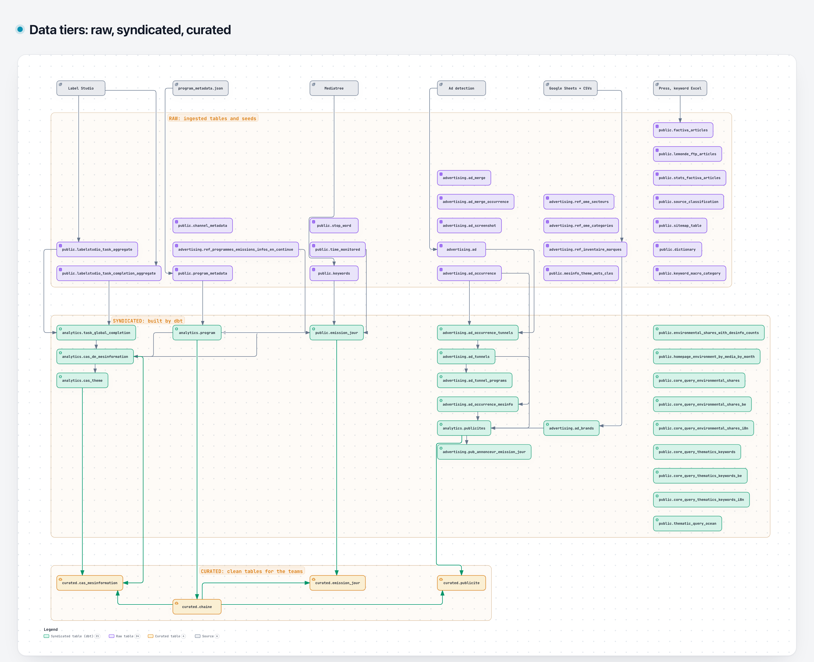
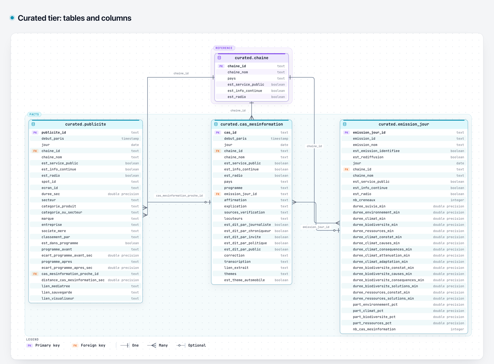

# Data tiers: raw, syndicated, curated

The `barometre` PostgreSQL database is organised in three tiers. A tier is defined by the **role** of a table (who writes it and how clean it is), not only by its schema name, so a few schemas hold tables of two tiers (see "Schema versus tier" below).



Interactive version: [`diagrams/data_tiers.html`](diagrams/data_tiers.html). Every box is one table, named `schema.table`; tables are grouped in columns by topic (annotations, programs, keywords, ads, references, press) from source to curated. The diagram shows the main dependencies only: each source is linked to its main table, and the dashboard tables of `public` are not linked. The lineage table below is complete for the dbt models.

| Tier | Schemas | Written by | Read by |
|---|---|---|---|
| **Raw** | `public` (ingested tables, seeds), `advertising` (`ad*` tables) | Ingestion jobs, `dbt seed` | dbt, ingestion/detection code |
| **Syndicated** | `analytics`, dbt models of `public`, dbt models of `advertising`, `metadata` | `entrypoints/dbt.sh` | Metabase dashboards, analysts, curated models |
| **Curated** | `curated` | `entrypoints/curated.sh` | Metabase questions, non-technical teams and their Claude (through the Metabase MCP) |

## Sources

| Source | Loaded by | Lands in |
|---|---|---|
| Mediatree (S3 transcripts, API) | `entrypoints/mediatree_import.sh`, `quotaclimat/data_processing/mediatree/api_import.py` | `keywords`, `stop_word`, `time_monitored` |
| `program_metadata.json` (git) | `transform_program.py` | `program_metadata`, `channel_metadata` |
| Label Studio (6 databases, one project per country, see `quotaclimat/data_ingestion/labelstudio/configs.py`) | `ingest_labelstudio.py`, first step of `entrypoints/dbt.sh` | `labelstudio_task_aggregate`, `labelstudio_task_completion_aggregate` |
| Google Sheets (brands, sectors, programmes) | `quotaclimat/data_ingestion/external_sources/download_external_sources.py` then `dbt seed` | `ref_*` seeds (`advertising` schema) |
| Versioned CSVs (misinformation theme keywords, Belgian references) | `dbt seed` | `mesinfo_theme_mots_cles` and other seeds of `seeds/themes` |
| Mediatree ad detection and LLM classification | `entrypoints/advertising_detection.sh` and the other `advertising_*.sh` | `advertising.ad`, `ad_occurrence`, `ad_merge`, `ad_merge_occurrence`, `ad_screenshot` |
| Factiva, Le Monde FTP, sitemaps, keyword dictionary | ingestion jobs, `transform_excel_to_json.py` | `factiva_articles`, `lemonde_ftp_articles`, `stats_factiva_articles`, `source_classification`, `sitemap_table`, `dictionary`, `keyword_macro_category` |

Label Studio is read through two source tables (`task`, `task_completion`) per database. The ingestion code concatenates them (a `UNION` across databases) and writes one row per task with a `country` column and a hash id (`task_aggregate_id`), so the same task id in two countries never collides.

## Raw

Tables as the pipeline received them, with no business logic: transcripts and keyword counts per 2-minute segment (`keywords`), the program grid, annotations, detected ads, press articles. The schema definitions are in `postgres/schemas/` (SQLAlchemy models, migrated with Alembic) and `quotaclimat/data_ingestion/labelstudio/models.py`. Seeds loaded by dbt (`ref_*`, `seeds/themes`) are also raw: they are copies of external references.

The press tables, sitemaps and the keyword dictionary are raw only: no dbt model reads them yet.

## Syndicated

Everything dbt builds from raw, ready to be read by dashboards. dbt runs in `entrypoints/dbt.sh` in this order: seeds, models outside advertising, `task_global_completion`, then the advertising models and the analytics tables built on them. Model documentation is in `my_dbt_project/README.md`.

| Model | Schema | Reads |
|---|---|---|
| `task_global_completion` | `analytics` | `labelstudio_task_aggregate`, `labelstudio_task_completion_aggregate` |
| `program` | `analytics` | `program_metadata`, Programmes sheet seed |
| `cas_de_mesinformation` | `analytics` | `task_global_completion`, `program_metadata`, `program` |
| `cas_theme` | `analytics` | `cas_de_mesinformation`, `mesinfo_theme_mots_cles` seed |
| `ad_brands`, `ad_occurrence_mesinfo`, `ad_occurrence_tunnels`, `ad_tunnels`, `ad_tunnel_programs` | `advertising` | `ad`, `ad_occurrence`, brand/sector seeds, `task_global_completion`, `program` |
| `publicites` | `analytics` | `ad_occurrence`, `program_metadata`, the advertising models above |
| `pub_annonceur_emission_jour` | `advertising` | `publicites`, `program` |
| `emission_jour` | `public` | `keywords`, `time_monitored`, `program`, `cas_de_mesinformation` |
| `environmental_shares_with_desinfo_counts`, `core_query_*`, `thematic_query_ocean`, `homepage_*` | `public` | `keywords`, `program_metadata` |
| `dbt_objects` | `metadata` | the dbt graph |

The tables are run with `--target analytics` in some Kestra flows (`dbt-analytics`) to refresh only the tables read by Metabase questions.

## Curated

Four tables for the teams and their Claude: `chaine`, `publicite`, `cas_mesinformation`, `emission_jour`.



Interactive version: [`diagrams/data_tiers_curated.html`](diagrams/data_tiers_curated.html).

Rules (details in `CLAUDE.md`, "Schéma curated"): real objects or high-level aggregates, already filtered, French names, units as suffixes, no internal pipeline codes, and `chaine_id` / `emission_jour_id` as join keys. Nothing in dbt reads a curated table. They are built by `entrypoints/curated.sh` (Kestra task `curated_and_metabase_docs`), which also pushes their documentation to Metabase. Columns are never renamed or removed, because Metabase questions depend on them.

| Curated table | Built from |
|---|---|
| `chaine` | `program_metadata` |
| `publicite` | `publicites`, `chaine` |
| `cas_mesinformation` | `cas_de_mesinformation`, `cas_theme`, `chaine` |
| `emission_jour` | `emission_jour`, `chaine` |

## Schema versus tier

- `public` holds raw tables and the syndicated tables built by dbt (`emission_jour`, dashboards, homepage). The dbt ones are listed in the Syndicated table above.
- `advertising` holds raw tables (the `ad*` tables created by Alembic and written by the detection pipeline) and syndicated tables (the dbt models and seeds-based references). dbt models of `models/advertising` and `pub_annonceur_emission_jour` are syndicated.
- `curated` and `analytics` hold one tier each.

## Updating the diagrams

Both diagrams are generated with [Archify](https://github.com/tt-a1i/archify) from `docs/diagrams/data_tiers.archify.json` (architecture, one node per table) and `docs/diagrams/data_tiers_curated.archify.json` (ERD, columns copied from `my_dbt_project/models/curated/_curated.yml`). After a model change, edit the JSON and render from the repo root:

```bash
node <archify>/bin/archify.mjs finalize architecture docs/diagrams/data_tiers.archify.json docs/diagrams/data_tiers.html --repo-root . --quality standard --json
node <archify>/bin/archify.mjs finalize erd docs/diagrams/data_tiers_curated.archify.json docs/diagrams/data_tiers_curated.html --repo-root . --quality standard --json
```

Then open each HTML in light theme, use **Export > PNG** and save as `docs/images/data_tiers.png` and `docs/images/data_tiers_curated.png`. Update `meta.repository.revision` to the commit the nodes' `sources` point to.
