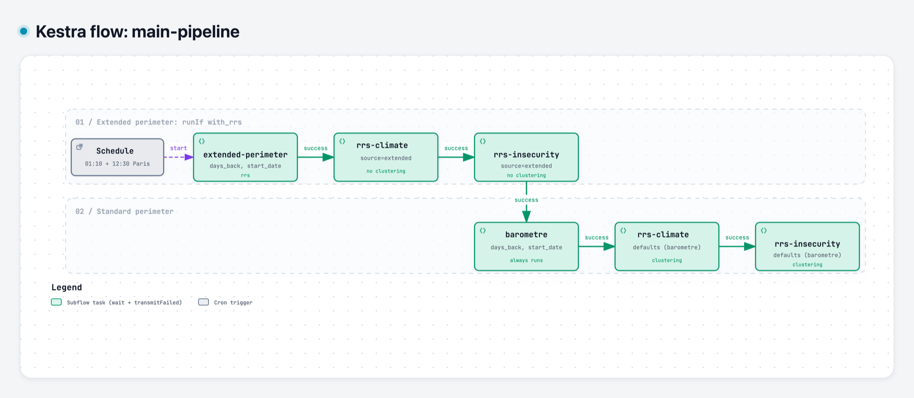
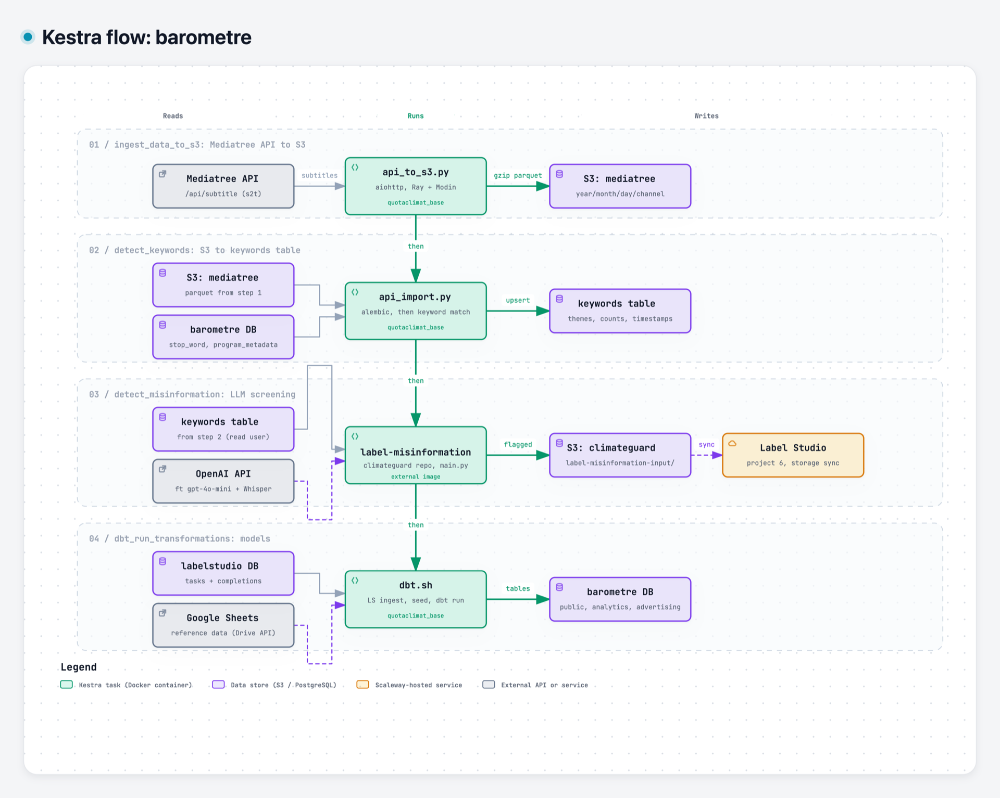
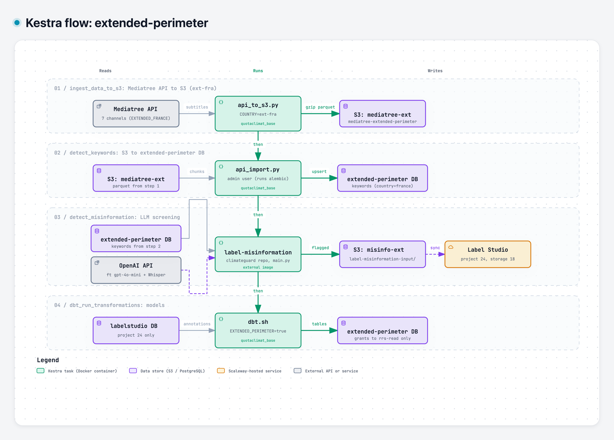
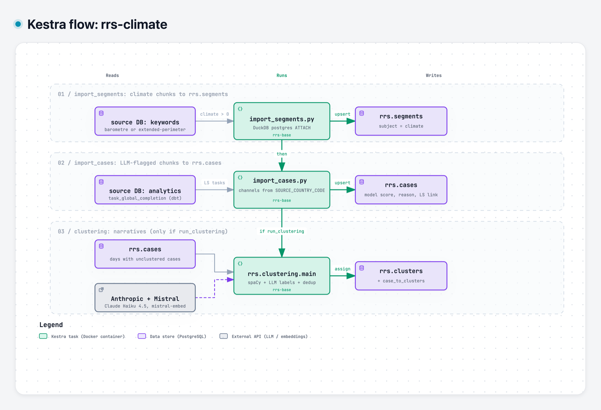
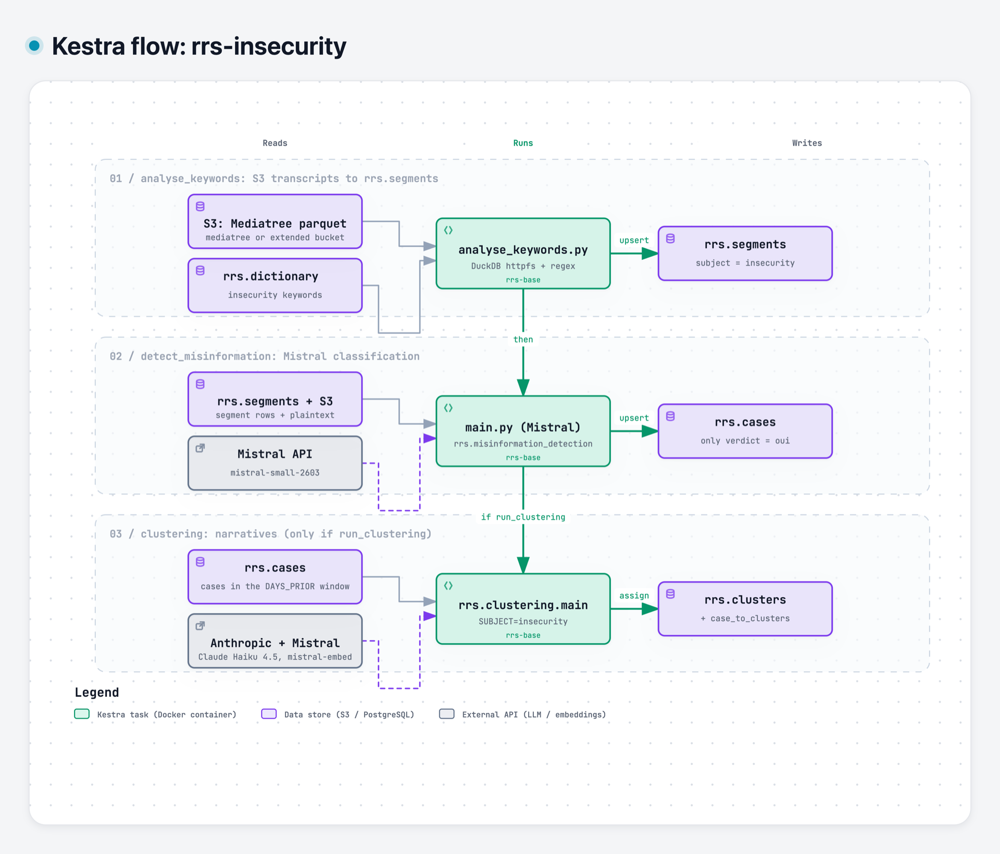
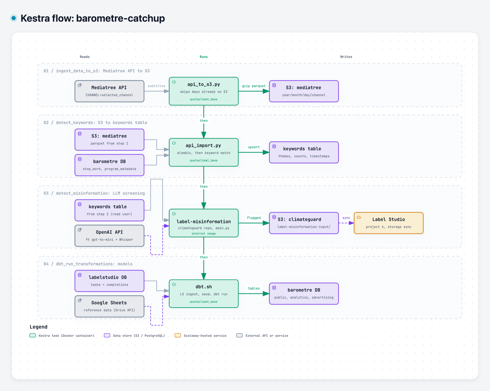
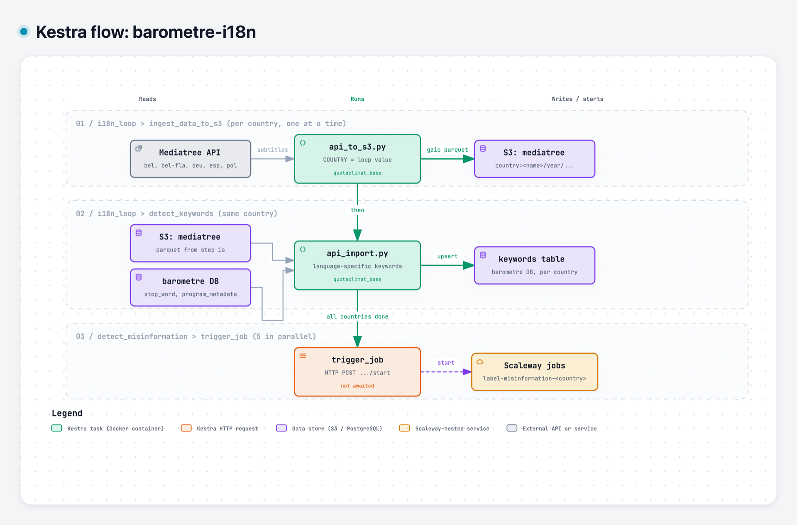
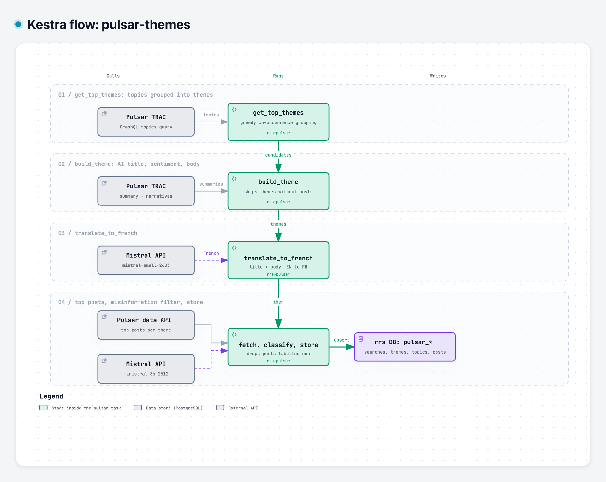

# Kestra flows in detail

This page explains, step by step, what each Kestra flow in `infrastructure/kestra/flows/` does, which code it runs and which technologies are involved. For the order in which the flows run, see the overview diagram in the root `README.md` ("Daily orchestration").

**Baromètre (OME).** The baromètre measures how much TV and radio airtime covers environmental topics. The data comes from Mediatree's speech-to-text transcripts. Each day, for every channel, the ingest step calls the Mediatree API once per program slot of the schedule grid. It stores the transcripts as 2-minute chunks in gzip parquet on Scaleway S3.

The keyword step then reads these chunks back and removes stop words such as ads and repeated phrases. It matches each chunk against the theme dictionaries (climate, biodiversity, resources and their sub-categories) and upserts the chunks that have at least one match into the `keywords` table, with their counts and their program. The chunks that mention the climate are screened for misinformation by a fine-tuned OpenAI classifier. Each suspicious chunk is re-transcribed with Whisper and sent to Label Studio, where annotators confirm or reject it.

Finally, dbt combines the keywords, program metadata, Label Studio annotations and reference spreadsheets from Google Drive into the tables that Metabase shows. France runs every day ([`barometre`](#barometre)), and [`barometre-catchup`](#barometre-catchup) re-runs the last 7 days every night to fill gaps. The other countries go through the first two steps in [`barometre-i18n`](#barometre-i18n), and that flow then starts their misinformation jobs on Scaleway.

**Droit à l'info (RRS).** Droit à l'info tracks misinformation on two subjects, climate and insecurity/immigration, and groups the cases into narratives. Its results go to the `rrs` database. It covers two TV perimeters:
- **The baromètre's French channels:** it reuses the baromètre's data.
- **The "extended perimeter":** 7 major channels (TF1, France 2, France 3 IDF, RTL, France 5, TMC, LCP). [`extended-perimeter`](#extended-perimeter) runs the same four baromètre steps on these channels, writing to a separate bucket, database and Label Studio project.

For each perimeter, the pipeline then works as follows:
- **Climate:** [`rrs-climate`](#rrs-climate) copies the climate chunks (`segments`) and the flagged, annotated chunks (`cases`) from the source database into `rrs`.
- **Insecurity:** the baromètre has no keywords for this subject, so [`rrs-insecurity`](#rrs-insecurity) detects it directly. It runs regex queries in DuckDB over the raw transcripts on S3, using the dictionary in `rrs.dictionary`. It then asks Mistral whether each matching segment contains misinformation, and stores only the "oui" answers as cases.
- **Clustering, for both subjects:** the cases of the day are grouped into narratives. Claude proposes and merges the labels, and `mistral-embed` deduplicates them against the narratives still active.
- **Social media:** separately, [`pulsar-themes`](#pulsar-themes) fetches the themes and top posts from Pulsar every night. Mistral translates them and classifies the posts.

[`main-pipeline`](#main-pipeline) chains the two projects every day. It runs the extended perimeter first, then the baromètre, and after each one it runs the two RRS subjects.

Each flow has its own diagram. Read it top to bottom: every horizontal lane is one Kestra task, in execution order. Inside a lane, the left side shows what the task reads, the middle shows the code it runs, and the right side shows what it writes. When a store written by one step is read by the next, it appears in both lanes (for example `S3: mediatree` at the end of step 1 and at the start of step 2).

| Flow | Namespace | File | Trigger |
|---|---|---|---|
| [`main-pipeline`](#main-pipeline) | `quotaclimat` | `main_quotaclimat_mainpipeline.yaml` | cron 01:10 and 12:30 |
| [`extended-perimeter`](#extended-perimeter) | `rrs` | `main_rrs_extendedperimeter.yaml` | `main-pipeline` step 1 |
| [`barometre`](#barometre) | `quotaclimat` | `main_quotaclimat_barometre.yaml` | `main-pipeline` step 4 |
| [`rrs-climate`](#rrs-climate) | `rrs` | `main_rrs_climate.yaml` | `main-pipeline` steps 2 and 5 |
| [`rrs-insecurity`](#rrs-insecurity) | `rrs` | `main_rrs_insecurity.yaml` | `main-pipeline` steps 3 and 6 |
| [`barometre-catchup`](#barometre-catchup) | `quotaclimat` | `main_quotaclimat_barometrecatchup.yaml` | cron 03:00 |
| [`barometre-i18n`](#barometre-i18n) | `quotaclimat` | `main_quotaclimat_barometrei18n.yaml` | cron 04:07 |
| [`pulsar-themes`](#pulsar-themes) | `rrs` | `main_rrs_pulsarthemes.yml` | cron 00:30 |

All times are Europe/Paris. Dev flows are covered [at the end](#dev-flows).

## Shared building blocks

### How a task runs

Except for `main-pipeline` (subflow calls) and the i18n Scaleway trigger (an HTTP request), every task is an `io.kestra.plugin.docker.Run`: Kestra pulls an image (`pullPolicy: ALWAYS`, so the latest pushed tag is used) from the Scaleway Container Registry and runs one entry point with environment variables. Credentials come from Kestra secrets (`{{ secret('...') }}`). Tasks in a flow run one after the other, and a failing task fails the flow.

| Image | Built from | Used by |
|---|---|---|
| `namespace-barometre/quotaclimat_base:latest` | this repo (`Dockerfile`) | ingest, keyword detection, dbt in `barometre*` and `extended-perimeter` |
| `misinformation/label-misinformation:latest` | [`dataforgoodfr/climateguard`](https://github.com/dataforgoodfr/climateguard) (`jobs/label_misinformation`) | `detect_misinformation` in `barometre`, `barometre-catchup`, `extended-perimeter` |
| `rrs-prod/rrs-base:prod` | this repo (`rrs/Dockerfile`) | every task of `rrs-climate` and `rrs-insecurity` |
| `rrs-prod/rrs-pulsar:prod` | this repo (`rrs/Dockerfile.pulsar`) | `pulsar-themes` |

### Date window

`barometre`, `barometre-catchup`, `barometre-i18n` and `extended-perimeter` take `days_back` and an optional `start_date`. Kestra converts `start_date` (or `now()` when it is empty) to an epoch in `START_DATE`, and passes `days_back` as `NUMBER_OF_PREVIOUS_DAYS`. The Python jobs process the `days_back` days before `START_DATE`. Because Kestra always sets `START_DATE`, the fallback in `api_import.py` that looks for gaps in the `keywords` table is never used by these flows.

The RRS flows (`rrs-climate`, `rrs-insecurity`, `pulsar-themes`) take `start_date`/`end_date` as `YYYY-MM-DD` strings and `days_back`. When nothing is set, each script picks its own window (described per step below).

### Technologies

| Technology | Role |
|---|---|
| [Kestra](https://kestra.io) | Scheduling, ordering, retries of the steps and secrets |
| Docker + Scaleway Container Registry | One image per code base; each task is a container run |
| [Mediatree](https://keywords.mediatree.fr) API | Source of TV/radio speech-to-text transcripts (`/api/subtitle`, `/api/v2/subtitle`) and audio export (`/api/export/single`) |
| Scaleway Object Storage (S3) | Raw transcripts as gzip parquet (`mediatree`, `mediatree-extended-perimeter-<env>`) and misinformation candidates (`climateguard`, `misinformation-extended-perimeter-<env>`) |
| PostgreSQL (Scaleway managed) | `barometre` (OME data), `extended-perimeter`, `rrs`, `labelstudio` databases |
| `aiohttp` + `asyncio` | Parallel Mediatree API calls (`API_TO_S3_CONCURRENCY=10`) |
| Ray + Modin | Parallel pandas for the ingest and keyword steps (`MODIN_ENGINE`, `MODIN_CPUS`, `MODIN_MEMORY`) |
| Regex, spaCy | Keyword matching on transcripts (regex for French, spaCy lemmas plus exact forms for other languages) |
| SQLAlchemy + Alembic | ORM, upserts and schema migrations of the `barometre`/`extended-perimeter` DBs |
| OpenAI API | Fine-tuned `gpt-4o-mini` misinformation classifier and Whisper re-transcription (in `label-misinformation`) |
| Label Studio | Human annotation of flagged transcripts; its Postgres DB is read back into `barometre` |
| Google Drive + Sheets API | Reference spreadsheets downloaded as dbt seeds |
| dbt | SQL models for Metabase (`public`, `analytics`, `dashboards`, `advertising` schemas) |
| DuckDB | RRS: attaches Postgres sources and reads S3 parquet (`httpfs`) |
| `psycopg` | RRS: Postgres reads and writes |
| Mistral API | RRS: insecurity misinformation classification, embeddings, Pulsar translation and post classification |
| Anthropic API | RRS: Claude Haiku 4.5 for narrative clustering |
| Pulsar TRAC API | Social media themes, topics and posts (GraphQL) |
| Sentry | Error and cron monitoring of the Python jobs |

## main-pipeline



Interactive version: [`diagrams/flows/main-pipeline.html`](diagrams/flows/main-pipeline.html).

The orchestrator of the daily chain. It runs no code of its own: each task is an `io.kestra.plugin.core.flow.Subflow` with `wait: true` and `transmitFailed: true`, so a step only starts when the previous one has succeeded, and a failure stops the run and marks `main-pipeline` as failed.

| Input | Default | Effect |
|---|---|---|
| `with_rrs` | `true` | `false` skips steps 1-3 and 5-6 (`runIf`), so only `barometre` runs |
| `days_back` | `1` | Passed to `extended-perimeter` and `barometre` |
| `start_date` | today | Passed to `extended-perimeter` and `barometre` as `YYYY-MM-DD` |

Steps:
1. `extended_perimeter`: [`extended-perimeter`](#extended-perimeter) with `days_back`, `start_date`.
2. `rrs_climate_extended`: [`rrs-climate`](#rrs-climate) with `source=extended`, `run_clustering=false`.
3. `rrs_insecurity_extended`: [`rrs-insecurity`](#rrs-insecurity) with `source=extended`, `run_clustering=false`.
4. `barometre`: [`barometre`](#barometre) with `days_back`, `start_date`.
5. `rrs_climate`: [`rrs-climate`](#rrs-climate) with its defaults (`source=barometre`, clustering on).
6. `rrs_insecurity`: [`rrs-insecurity`](#rrs-insecurity) with its defaults (`source=barometre`, clustering on).

The RRS subflows receive no dates: `rrs-climate` resumes from what is already in the `rrs` DB, and `rrs-insecurity` uses its own `days_back` default of 1.

## barometre



Interactive version: [`diagrams/flows/barometre.html`](diagrams/flows/barometre.html).

The main OME pipeline for France (`COUNTRY=fra`): it fetches yesterday's TV/radio transcripts, finds environmental keywords, screens the matching chunks for misinformation and rebuilds the dbt models used by Metabase. Inputs: `days_back` (default 1) and `start_date` (default now).

### 1. `ingest_data_to_s3`: Mediatree API to S3

- **Runs:** `quotaclimat/data_processing/mediatree/s3/api_to_s3.py` in `quotaclimat_base`.
- **What happens:** for each day of the window and each French channel, the job takes the program grid (`program_metadata`), calls the Mediatree subtitle API once per program slot (`type_sub=s2t`, up to 10 requests in parallel with `aiohttp`) and turns the responses into a dataframe of 2-minute transcript chunks. Each channel/day is written as gzip parquet to the `mediatree` bucket under `year=/month=/day=/channel=` (France has no `country=` prefix, for legacy reasons). `API_DATA_OVERWRITE=1` makes the job fetch again and overwrite a channel/day that already exists, because the Mediatree API is not always stable from one call to the next. A Ray runtime and a health-check server are started alongside.
- **Technologies:** Mediatree API, `aiohttp`, Ray + Modin, pandas/pyarrow parquet, `boto3` to Scaleway S3, Sentry cron monitor `api-to-s3`.
- **Reads:** Mediatree API (`MEDIATREE_USER`/`MEDIATREE_PASSWORD`). **Writes:** S3 `mediatree`.

### 2. `detect_keywords`: S3 to the `keywords` table

- **Runs:** `entrypoints/detect_keywords.sh` in `quotaclimat_base`, which runs `alembic upgrade head`, refreshes the program metadata (`transform_program.py`) and then `quotaclimat/data_processing/mediatree/api_import.py`.
- **What happens:** for each day and channel, the parquet folder is read back from S3 and every chunk is matched against the keyword dictionary (climate, biodiversity, resources and their sub-categories). Validated stop words (ads and repeated phrases from the `stop_word` table) are removed from the text first. Each match gets a timestamp, and counts are computed per 20-second window, with and without "high risk false positive" keywords. Chunks without any theme are dropped. Rows are mapped to their program, given a hash id and upserted into `keywords` (`BATCH_SIZE=5000`). The number of rows read per channel/day is logged in `time_monitored`.
- **Technologies:** Alembic, Ray + Modin (`MODIN_ENGINE=ray`), regex keyword matching, SQLAlchemy upserts. `logLevel: WARN` keeps the per-row logs out of the Kestra UI.
- **Reads:** S3 `mediatree`, `barometre.stop_word`, program metadata. **Writes:** `barometre.keywords`, `barometre.time_monitored`.

### 3. `detect_misinformation`: LLM screening

- **Runs:** `python /app/main.py` in the `label-misinformation` image, built from the [climateguard](https://github.com/dataforgoodfr/climateguard) repo (code not in this repo).
- **What happens:** the job reads the chunks with climate keywords from `barometre.keywords` (with the read-only user) over `days_back + 1` days, and asks a fine-tuned OpenAI model (`MODEL_NAME=ft:gpt-4o-mini-...`) to score them. Chunks classified as misinformation get their audio fetched from Mediatree (`/api/export/single`) and re-transcribed with Whisper, then are saved to the `climateguard` bucket (`label-misinformation-input/`). The job then calls Label Studio's storage sync, so they appear as tasks in project 6 (S3 storage id 4) for annotators. `LABEL_MISINFORMATION_OVERWRITE=1` reprocesses the window.
- **Technologies:** OpenAI API (fine-tuned `gpt-4o-mini`, Whisper), Scaleway S3, Label Studio API.
- **Reads:** `barometre.keywords`, Mediatree export API. **Writes:** S3 `climateguard`, Label Studio project 6.

### 4. `dbt_run_transformations`: models

- **Runs:** `entrypoints/dbt.sh` in `quotaclimat_base`.
- **What happens**, in order:
  1. `quotaclimat.data_ingestion.labelstudio.ingest_labelstudio` copies Label Studio tasks and annotations from the `labelstudio` DB into `barometre` (`labelstudio_task_aggregate`, `labelstudio_task_completion_aggregate`).
  2. `quotaclimat.data_ingestion.external_sources.download_external_sources` downloads the reference spreadsheets listed in `my_dbt_project/external_sources.yml` from the Drive folder in `EXTERNAL_SOURCES_DRIVE_FOLDER`, using the service account in `GOOGLE_SHEETS_SERVICE_ACCOUNT_JSON`. Spreadsheets readable without credentials are refused. Then `dbt seed` and `dbt test` load and check them.
  3. `dbt run --full-refresh` builds the core models. Causal links, the analytics tables and the advertising models are excluded here.
  4. `dbt run --target analytics` builds `task_global_completion` and `environmental_shares_with_desinfo_counts`.
  5. A last `dbt run` builds the advertising models, `cas_de_mesinformation` and `publicites`, which read the analytics tables.
- **Technologies:** dbt (Postgres adapter), Google Drive and Sheets APIs, SQLAlchemy.
- **Reads:** `labelstudio` DB, Google Sheets, `barometre`. **Writes:** `barometre` schemas `public`, `analytics`, `dashboards`, `advertising`.

## extended-perimeter



Interactive version: [`diagrams/flows/extended-perimeter.html`](diagrams/flows/extended-perimeter.html).

The same four steps and the same code as [`barometre`](#barometre), run for the "Droit à l'info" extended perimeter: the 7 channels of `EXTENDED_FRANCE` (`tf1`, `france2`, `fr3-idf`, `rtl`, `france5`, `tmc`, `lcp`, with their own program grid), with `COUNTRY=ext-fra`. Inputs: `days_back` (default 1), `start_date` (default now). Differences from `barometre`:

| Step | Difference |
|---|---|
| `ingest_data_to_s3` | Bucket `mediatree-extended-perimeter-prod`, written with `RRS_SCW_ACCESS`/`RRS_SCW_SECRET`. No `API_DATA_OVERWRITE`, so channel/days already on S3 are skipped. Since `ext-fra` is not the legacy France code, objects get a `country=france/` prefix. |
| `detect_keywords` | Writes to the `extended-perimeter` DB on the RRS Postgres instance (port 18492) with the admin user `RRS_PG_ADMIN_USER`, because `alembic upgrade head` needs DDL rights. Rows keep `country=france`, so the DB has the same content shape as `barometre`. |
| `detect_misinformation` | `misinformation-extended-perimeter-prod` bucket, Label Studio project 24 (S3 storage id 18), looks back `days_back` days (not `+1`). |
| `dbt_run_transformations` | `EXTENDED_PERIMETER=true`: Label Studio ingestion only keeps project 24 (`configs.py`), and dbt grants `select` only to `rrs-read-prod`. No `EXTERNAL_SOURCES_DRIVE_FOLDER`, so the Google Sheets download is skipped. |

## rrs-climate



Interactive version: [`diagrams/flows/rrs-climate.html`](diagrams/flows/rrs-climate.html).

Copies the climate chunks and the misinformation cases of a source DB into the RRS (Risk Response System) database, then groups the cases into narratives. All three tasks run in `rrs-base`.

| Input | Default | Effect |
|---|---|---|
| `source` | `barometre` | `barometre`: OME DB (port 22737), bucket `mediatree`, `SOURCE_COUNTRY_CODE=fra`, Label Studio project 6 / tab 121. `extended`: `extended-perimeter` DB on the RRS host (port 18492), bucket `mediatree-extended-perimeter-prod`, `ext-fra`, project 24 / tab 139. Both are read with the `RRS_BAROMETRE_READ_*` user. |
| `start_date`, `end_date` | empty | Explicit window for all steps |
| `days_back` | empty | Window for clustering only |
| `run_clustering` | `true` | `false` skips step 3 |

### 1. `import_segments`: climate chunks to `rrs.segments`

- **Runs:** `python -m rrs.keyword_detection.import_segments`.
- **What happens:** DuckDB attaches the source Postgres DB read-only and selects the `keywords` rows with `number_of_keywords_climat > 0` and `country='france'`. Without a `start_date`, the window starts at the latest `segments.start` already in the RRS DB and ends now. Each row becomes a segment with subject `climate`, its keywords, its S3 folder URI and a Mediatree link. DuckDB then attaches the RRS DB and upserts into `segments` on `(segment_id, subject_id)`.
- **Technologies:** DuckDB `postgres` extension, `psycopg`.

### 2. `import_cases`: flagged chunks to `rrs.cases`

- **Runs:** `python -m rrs.keyword_detection.import_cases`.
- **What happens:** reads `analytics.task_global_completion` in the source DB (the dbt model built from the Label Studio tasks and annotations; each task carries the `label-misinformation` model result) for the channels of the source perimeter. Without dates, the window runs from the latest case to the latest segment in the RRS DB. Each task becomes a case with the model score and reason, the Whisper transcript, the labelling status and the human verdict (`mesinfo_choice`), plus a Label Studio link built from `LABEL_STUDIO_PROJECT`/`LABEL_STUDIO_TAB_ID`. Rows are upserted into `cases`.
- **Technologies:** DuckDB `postgres` extension, `psycopg`.

### 3. `clustering`: narratives (only when `run_clustering`)

- **Runs:** `python -m rrs.clustering.main` with `SUBJECT=climate`.
- **What happens:** without dates, it finds the days that have cases without a cluster assignment (after the latest clustered day) and processes them one by one:
  - Step 0 drops cases that are not really about the subject.
  - The text is split into sentence windows with spaCy `fr_core_news_sm` (`WINDOW_SIZE=3`, `OVERLAP_TOKENS=30`).
  - Step 1: the LLM proposes narrative labels per case.
  - Step 2: the labels are merged in tournament rounds (`MERGE_BATCH_SIZE=30`, `MERGE_MAX_ROUNDS=5`), with a cluster count target between `MIN_CLUSTERS` and `MAX_CLUSTERS`.
  - Step 2b-2d: the merged labels are compared with the clusters still active in the DB (used in the last `EXPIRY_DAYS=30` days), using `mistral-embed` similarity. Below 0.4 a label is kept, above 0.85 it is dropped, and in between Claude decides.
  - Step 3: every case is classified against the new and active labels.
  - New clusters and the assignments are written to `clusters` and `case_to_clusters`.
- **Technologies:** spaCy, Anthropic API (`PROVIDER=anthropic`, Claude Haiku 4.5), Mistral embeddings (`EMBEDDING_BACKEND=mistral`), `asyncio` (`MAX_CONCURRENT_REQUESTS=5`).

Clustering selects cases by subject, not by source. With `run_clustering=false`, the extended cases are not clustered in the extended run, but the next `source=barometre` run picks up every unclustered day in `rrs.cases`, extended cases included.

## rrs-insecurity



Interactive version: [`diagrams/flows/rrs-insecurity.html`](diagrams/flows/rrs-insecurity.html).

Insecurity/immigration has no keyword pipeline in the OME, so this flow detects it directly from the raw transcripts on S3. It has the same inputs as `rrs-climate`, but `days_back` defaults to 1 and is used by every step (`DAYS_PRIOR`). When `source=extended`, the bucket is read with `RRS_SCW_ACCESS`/`RRS_SCW_SECRET`. All tasks run in `rrs-base` with `SUBJECT=insecurity`.

### 1. `analyse_keywords`: S3 transcripts to `rrs.segments`

- **Runs:** `python -m rrs.keyword_detection.analyse_keywords`.
- **What happens:** loads the insecurity keywords from `rrs.dictionary`, split into validated, high-risk false positive and not-yet-validated lists. Then, one day at a time, DuckDB reads the day's parquet files for the French channels from S3 and runs one regex query. A chunk is kept when it contains a validated keyword and no high-risk false positive, or enough non-validated keywords together. Matches are upserted into `segments` with subject `insecurity`.
- **Technologies:** DuckDB `httpfs` on Scaleway S3, regex (`regexp_extract_all`), SQLAlchemy (dictionary), DuckDB `postgres` extension (upsert).

### 2. `detect_misinformation`: Mistral classification

- **Runs:** `python -m rrs.misinformation_detection.main`.
- **What happens:** loads the insecurity segments of the window from `rrs.segments` and fetches their plaintext from the parquet files on S3 (DuckDB). Each text is sent to Mistral (`mistral-small-2603`, 10 concurrent requests). The system prompt is built from the subject definition in `definitions.py`. The answer is structured: `oui`/`non`/`incertain`, a confidence score and a justification. Only `oui` segments are upserted into `cases`, with the label as score and the justification as reason.
- **Technologies:** Mistral API, DuckDB `httpfs`, `psycopg`, `asyncio`.

### 3. `clustering`

Same code as [`rrs-climate` step 3](#3-clustering-narratives-only-when-run_clustering) with `SUBJECT=insecurity`. Since `days_back` is always set here, it clusters the cases of the `DAYS_PRIOR` window instead of looking for unprocessed days.

## barometre-catchup



Interactive version: [`diagrams/flows/barometre-catchup.html`](diagrams/flows/barometre-catchup.html).

A safety net that runs [`barometre`](#barometre)'s four steps every night at 03:00 on a longer window, to fill in anything the daily runs missed. Differences:

- `days_back` defaults to 7.
- `selected_channel` (optional) is passed as `CHANNEL` to steps 1-3 to rerun a single channel.
- Step 1 has no `API_DATA_OVERWRITE`: only channel/days that are missing from S3 are fetched again.
- Step 2 re-reads the whole window from S3 and upserts, so it is idempotent.
- Step 3 looks back `days_back` days and runs without `LABEL_MISINFORMATION_OVERWRITE`.
- Step 4 is identical.

## barometre-i18n



Interactive version: [`diagrams/flows/barometre-i18n.html`](diagrams/flows/barometre-i18n.html).

The OME pipeline for the other countries, every day at 04:07. Inputs: `days_back` (default 1), `start_date` (default now).

1. **`i18n_loop`** (`ForEach` over `bel`, `bel-fla`, `deu`, `esp`, `pol`, one country at a time) runs two tasks per country:
   - `ingest_data_to_s3`: same as `barometre` step 1 with `COUNTRY` set to the loop value. Objects go to the `mediatree` bucket under `country=<name>/year=/...`, and channels and program grids come from that country's config.
   - `detect_keywords`: same as `barometre` step 2, writing to `barometre.keywords` with the country's name. Keywords are filtered on the country's language. Non-French languages are matched on spaCy lemmas plus exact forms, instead of the French regex.
2. **`detect_misinformation`** (`ForEach` over five Scaleway job definition ids, all in parallel): a `trigger_job` HTTP POST to the Scaleway Serverless Jobs API starts one `label-misinformation-<country>` job per country (deployed from the climateguard repo, token `CLIMATESAFEGUARDS_SCW_SECRET`). Kestra does not wait for them: the polling loop is commented out, so their success or failure is not visible in this flow.

The dbt task is commented out in the YAML, so this flow does not rebuild the models. They are rebuilt by the next `barometre` run.

## pulsar-themes



Interactive version: [`diagrams/flows/pulsar-themes.html`](diagrams/flows/pulsar-themes.html).

Pulls social media "themes" (clusters of topics, like Pulsar's "What's the story?" tab) into the RRS DB every day at 00:30. The flow is a `ForEach` over the `searches` input, one search at a time. Each search is a JSON object with `folder_id`, `search_id` and `subject` (`climate` or `insecurity`), and the default list has four searches. For each search, a single `rrs-pulsar` container runs `python -m rrs.pulsar.fetch_weekly_themes_client`. The lanes in the diagram are its internal stages:

1. **`get_top_themes`:** calls the Pulsar TRAC GraphQL `topics` query for the window (`days_back`, default 1, or `start_date`/`end_date`). Topics are grouped into themes greedily: each unassigned top topic seeds a theme and pulls in its strongest co-occurring topics. A theme's volume is the sum of its topics' volumes.
2. **`build_theme`:** for each theme, fetches representative sentences with `summary` and asks Pulsar's `narrativesSummarization` for a title, sentiment and body. Themes without posts or with malformed output are skipped.
3. **`translate_to_french`:** titles and bodies are translated from English to French with Mistral (`mistral-small-2603`), and sentiment labels are mapped to French.
4. **Fetch, classify, store:** for each theme, the top `n_top_posts` (default 30) posts come from the Pulsar data GraphQL endpoint and are classified for misinformation with Mistral (`ministral-8b-2512`). Posts labelled `non` are dropped. The search, themes, topics, posts and theme-post links are upserted into the `pulsar_*` tables of the `rrs` DB.

**Technologies:** Pulsar TRAC GraphQL API (permanent API key), Mistral API, `psycopg`, Python 3.12 slim image (no browser; the Playwright download script `download_themes.py` is not used by this flow).

## Dev flows

Every prod flow except `barometre-catchup` and `barometre-i18n` has a dev twin: `main_quotaclimatdev_mainpipeline.yaml` and `main_quotaclimatdev_barometre.yaml` (namespace `quotaclimat-dev`), and `main_rrsdev_*.yaml` (namespace `rrs-dev`). They run the same tasks with the `_DEV` secrets, `-dev` buckets, dev databases, `DBT_ENV=dev` and the dev Label Studio project for the extended perimeter (23 / tab 137). The dev `main-pipeline` has no schedule.

## Updating the diagrams

Each diagram is generated with [Archify](https://github.com/tt-a1i/archify) (3.0.1, `workflow` type) from a JSON source in `docs/diagrams/flows/<flow>.archify.json`. Each node lists the repository lines it was drawn from (`sources`, pinned to a commit in `meta.repository`). After a flow changes, edit its JSON, then render it from the repo root with the Archify skill package:

```bash
node <archify>/bin/archify.mjs finalize workflow docs/diagrams/flows/<flow>.archify.json docs/diagrams/flows/<flow>.html --repo-root . --quality showcase --json
```

Then open the HTML, use **Export > PNG** (light theme) and save it as `docs/images/flows/<flow>.png`.
